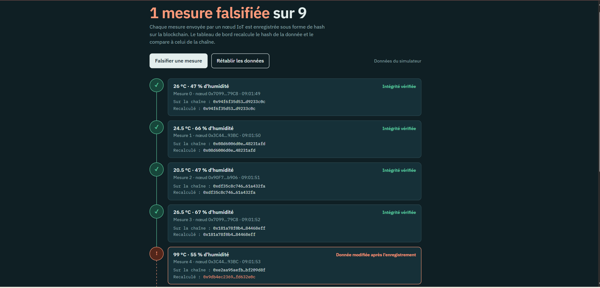

# Réseau IoT sécurisé par blockchain

Prototype qui garantit l'**authenticité** et l'**intégrité** des mesures de capteurs IoT grâce à un smart contract Solidity.



## Problème

Dans un réseau IoT (température, humidité, etc.), rien ne prouve qu'une mesure n'a pas été modifiée après son envoi, ni qu'elle vient d'un capteur légitime.

## Solution

- Seuls les **nœuds autorisés par l'administrateur** peuvent enregistrer une mesure.
- La blockchain ne stocke pas la donnée brute, mais son **hash** (keccak256), avec l'adresse du nœud et la date.
- Pour vérifier une mesure, on **recalcule le hash** de la donnée et on le compare à celui de la chaîne. S'il diffère, la donnée a été falsifiée.

## Architecture

```
Nœuds IoT (simulés) ──hash──▶ Smart contract MesureLog ◀── Tableau de bord
        │                         (blockchain Hardhat)            ▲
        └── donnée brute ──▶ dashboard-data.json ─────────────────┘
```

## Technologies

Solidity · Hardhat 3 · TypeScript · ethers.js v6 · HTML/CSS/JavaScript

## Structure du projet

| Dossier / fichier | Rôle |
|---|---|
| `contracts/MesureLog.sol` | Smart contract (autorisation des nœuds, enregistrement des mesures) |
| `test/Mesurelog.ts` | Tests automatisés du contrat |
| `scripts/demo.ts` | Démo simple : déploiement, autorisation, enregistrement, vérification |
| `scripts/simulateur.ts` | Simulation de 3 nœuds, d'un intrus et d'une falsification |
| `dashboard.html` | Tableau de bord de vérification d'intégrité |

## Installation

Prérequis : Node.js (v22 recommandé) et npm.

```bash
git clone https://github.com/Wided-103/projet-blockchain.git
cd projet-blockchain
npm install
```

## Utilisation

**1. Lancer les tests**

```bash
npx hardhat test
```

**2. Lancer la simulation**

```bash
npx hardhat run scripts/simulateur.ts
```

Résultat attendu :

```
Mesures enregistrées : 9
Intrus refusé
Mesure 4 falsifiée !
Intégrité : 8/9 valides
```

Le script génère `dashboard-data.json`.

**3. Ouvrir le tableau de bord**

```bash
npx serve .
```

Puis ouvrir `http://localhost:3000/dashboard.html`.

Le bouton « Falsifier une mesure » modifie une donnée côté navigateur pour montrer la détection en direct.

## Scénarios démontrés

1. **Autorisation** : seul l'administrateur peut autoriser un nœud.
2. **Rejet d'intrus** : un nœud non autorisé ne peut pas enregistrer de mesure.
3. **Traçabilité** : chaque mesure est horodatée et liée à son nœud.
4. **Détection de falsification** : toute modification de la donnée change son hash.

## Limites

- Les mesures sont **simulées** (valeurs aléatoires), il n'y a pas de capteur physique.
- La blockchain est un **réseau local Hardhat**, pas un réseau public.
- Les données brutes sont stockées hors chaîne (`dashboard-data.json`) ; seule l'empreinte est sur la blockchain.

## Pistes d'amélioration

- Connecter un **ESP32 avec capteur DHT22** pour des mesures réelles.
- Déployer sur un réseau de test (Sepolia).
- Lire directement les mesures depuis la blockchain dans le tableau de bord.

## Auteure

Wided Jbili, étudiante en Licence Ingénierie des Systèmes Informatiques, ISSAT Kairouan.